# I2C Master/Slave IP Core

[](https://github.com/Srishanth6/I2C-Master-Slave-IP-Core/actions/workflows/ci.yml)
[](LICENSE)

An I2C master and slave IP core in synthesizable Verilog, written from scratch, with an AMBA APB
register interface and self-checking testbenches. The master supports START, repeated START and STOP,
7- and 10-bit addressing, reads and writes with ACK/NACK, a programmable SCL prescaler (Standard-mode 100 kHz and
Fast-mode, checked against the I2C timing limits), multi-master arbitration, a command-ready /
reject mechanism, an SCL-low timeout and a bus-recovery command. The slave has a programmable 7- or 10-bit address, a 16 x 8
register file and clock stretching. All results below are copied from the logs in [`logs/`](logs),
produced on Windows with Icarus Verilog 12. The same regression runs on every push in GitHub Actions
(Ubuntu, Icarus Verilog from apt).

**Author:** B. Srishanth Reddy

📄 **Full report:** [report/I2C_IP_Core_Report.pdf](report/I2C_IP_Core_Report.pdf)

## Features

**Master (`rtl/i2c_master.v`)**
- Byte-level command interface: one command = optional START (also repeated START), one WRITE or READ byte, optional STOP
- 7-bit and 10-bit addressing (10-bit header `11110 A9 A8 R/W` + low address byte)
- ACK/NACK: reports slave NACK (`rx_nack`), sends ACK or NACK after each read byte (`cmd_nack`)
- SCL = f_clk / (4 x (PRESCALE + 1) + 3) (measured, see [Timing](#timing-compliance)); 50 MHz: PRESCALE 124 = 99.40 kHz, 32 = 370.37 kHz (fastest setting that meets Fast-mode tLOW)
- START / repeated START / STOP phases are twice as long so tSU;STA, tHD;STA and tSU;STO meet the Standard-mode limits
- SCL-low timeout (parameter `TIMEOUT_CLKS`, default 1 250 000 clocks = 25 ms at 50 MHz): if SCL is held low by another device the master aborts, releases the bus and sets `timeout`
- Waits for SCL to really go high before timing the high phase, so it supports slave clock stretching and multi-master clock synchronisation
- Arbitration-loss detection: if it releases SDA but reads 0 while SCL is high, it releases the bus at once and sets `arb_lost`
- Bus-busy detection (START/STOP monitor) and 2-flop synchronisers on SCL/SDA

**Slave (`rtl/i2c_slave.v`)**
- Programmable 7-bit or 10-bit own address (`addr10_en`)
- 16 x 8 register file (parameter `NREG`) with an auto-incrementing register pointer
- Write: `S ADDR+W PTR D0 D1 .. P`; read: `S ADDR+W PTR Sr ADDR+R D0 .. Dn(NACK) P`
- Clock stretching: holds SCL low for `stretch_cycles` clocks after every ACK bit
- START / repeated START / STOP detection from any state

**APB wrapper (`rtl/i2c_apb.v`)**
- AMBA 3 APB slave, zero wait states, `irq` on command done or on a rejected command
- `STATUS.cmd_ready`: a CMD write is only accepted when the master is idle; a CMD written while busy, or an invalid command (READ+WRITE, RECOVER combined with other bits), is **dropped** and sets the sticky `STATUS.cmd_err` (W1C). Nothing is sent on the bus.
- `CMD.RECOVER`: bus-recovery sequence for a slave that holds SDA low (9 SCL pulses with SDA released, then STOP), as in UM10204 section 3.1.16
- `STATUS.scl`/`STATUS.sda` show the synchronised bus lines so software can see a stuck bus

**Open-drain bus model**: every driver only pulls low (`assign scl = oe ? 1'b0 : 1'bz;`), and the bus wires are `tri1` (pull-ups), so the bus is a real wired-AND.

## Architecture

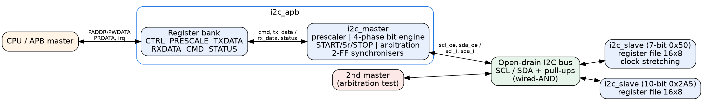

Each bit (and each START/STOP) is split into 4 phases of PRESCALE+1 clocks:

| Phase | SCL | SDA |
|---|---|---|
| ph0 | low | master sets the data bit (or releases it to read) |
| ph1 | released; the timer waits until SCL is really high (stretching / clock sync) | sampled at the end of ph1; arbitration is checked here |
| ph2 | high | held (START: SDA falls here, STOP: SDA rises here) |
| ph3 | low | held |

### Master FSM
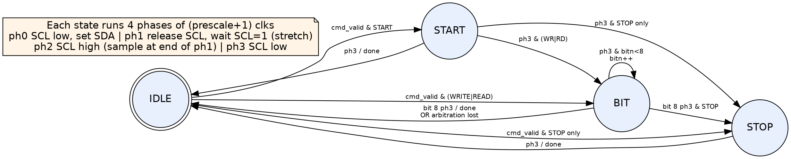

### Slave FSM
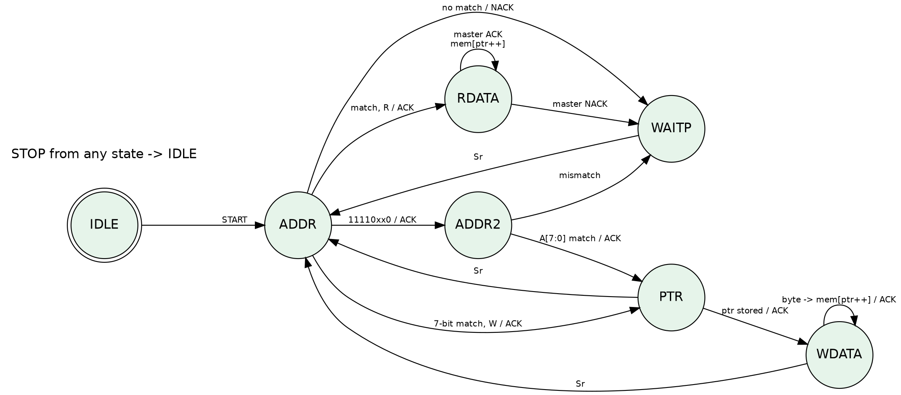

## Register map (`i2c_apb`)

| Offset | Name | Access | Bits | Description |
|---|---|---|---|---|
| 0x00 | CTRL | RW | [0] `irq_en` | interrupt enable |
| 0x04 | PRESCALE | RW | [15:0] | SCL = PCLK / (4 x (PRESCALE+1) + 3), reset 124 (99.4 kHz at 50 MHz) |
| 0x08 | TXDATA | RW | [7:0] | byte to send (address byte or data) |
| 0x0C | RXDATA | RO | [7:0] | last byte read |
| 0x10 | CMD | WO | [0] START [1] STOP [2] READ [3] WRITE [4] NACK [5] RECOVER | accepted only if `cmd_ready`=1 and the command is valid |
| 0x14 | STATUS | RO / W1C | see below | reset value 0x340 |

| STATUS bit | Name | Meaning |
|---|---|---|
| 0 | busy | master is executing a command |
| 1 | rx_nack | last byte written was NACKed |
| 2 | arb_lost | arbitration lost (master released the bus) |
| 3 | done | command finished (W1C) |
| 4 | bus_busy | a START has been seen and no STOP yet (any master) |
| 5 | cmd_err | a CMD write was rejected: busy, or invalid command (sticky, W1C) |
| 6 | cmd_ready | a new CMD will be accepted (master idle, nothing pending) |
| 7 | timeout | the last command was aborted because SCL stayed low longer than `TIMEOUT_CLKS` |
| 8 / 9 | scl / sda | synchronised bus line levels |

`irq = irq_en & (done | cmd_err)`.

**Software rule:** before writing CMD, poll `STATUS.cmd_ready` (or wait for `STATUS.done`). TXDATA may be
written at any time; it is latched when the command is accepted. Check `rx_nack`, `arb_lost` and
`timeout` after `done`. If `cmd_err` is set, the command was not executed: clear it (write 1) and retry.
If the bus is stuck (`STATUS.sda`=0 while idle, or after `timeout`), issue `CMD=RECOVER`.

Example software sequence, write 0xDE to register 0 of slave 0x50:
```
TXDATA=0xA0; CMD=START|WRITE;  poll STATUS.done, check STATUS.rx_nack==0
TXDATA=0x00; CMD=WRITE;        poll STATUS.cmd_ready (or done)
TXDATA=0xDE; CMD=WRITE|STOP;   poll STATUS.done, check rx_nack, cmd_err
```

## Interface

| Module | Port | Dir | Width | Description |
|---|---|---|---|---|
| master | `prescale` | in | 16 | SCL prescaler |
| master | `cmd_valid`, `cmd_start`, `cmd_stop`, `cmd_read`, `cmd_write`, `cmd_nack` | in | 1 | command strobe and fields |
| master | `tx_data` / `rx_data` | in / out | 8 | byte to send / byte received |
| master | `done`, `rx_nack`, `arb_lost`, `busy`, `bus_busy`, `timeout` | out | 1 | status |
| master, slave | `scl_i`, `sda_i` / `scl_oe`, `sda_oe` | in / out | 1 | open-drain pads (`oe`=1 pulls low) |
| slave | `own_addr`, `addr10_en` | in | 10, 1 | own address and mode |
| slave | `stretch_en`, `stretch_cycles` | in | 1, 16 | clock stretching control |
| slave | `addressed`, `wr_strobe` | out | 1 | selected flag, register-write pulse |

## Timing compliance

The bit engine splits each SCL period into 4 phases of PRESCALE+1 clocks; in phase 1 the counter waits
until the synchronised SCL is really high (stretching/clock sync), which adds 3 clocks (2-flop
synchroniser + one compare). Measured in simulation and in `tb_i2c_timing`:

**f_SCL = f_clk / (4 x (PRESCALE + 1) + 3)**,  tLOW = 2(P+1) clocks, tHIGH = 2(P+1) + 3 clocks

| PRESCALE (50 MHz) | Formula | Measured SCL period | Mode |
|---|---|---|---|
| 124 | 99.40 kHz | 10 060 ns | Standard-mode: all limits PASS |
| 32 | 370.37 kHz | 2 700 ns | Fast-mode: all limits PASS (fastest compliant setting) |
| 30 | 393.70 kHz | 2 540 ns | **Fast-mode tLOW 1240 ns < 1300 ns: violation, detected by the checker** |
| 10 | 1 063.83 kHz | 940 ns | formula check only |

The earlier "400 kHz" setting (PRESCALE=30) violates Fast-mode tLOW, so Fast-mode now uses PRESCALE=32.
Worst-case values measured by the bus monitor `tb/i2c_monitor.v` on the laptop (`logs/tb_i2c_timing.log`):

| Parameter | Standard-mode (P=124) | Limit | Fast-mode (P=32) | Limit | Result |
|---|---|---|---|---|---|
| tLOW | 5000 ns | ≥ 4700 | 1320 ns | ≥ 1300 | PASS |
| tHIGH | 5060 ns | ≥ 4000 | 1380 ns | ≥ 600 | PASS |
| tSU;STA | 5060 ns | ≥ 4700 | 1380 ns | ≥ 600 | PASS |
| tHD;STA | 5000 ns | ≥ 4000 | 1320 ns | ≥ 600 | PASS |
| tSU;DAT | 2500 ns | ≥ 250 | 660 ns | ≥ 100 | PASS |
| tHD;DAT | 60 ns | ≥ 0 | 60 ns | ≥ 0 | PASS |
| tVD;DAT | 2560 ns | ≤ 3450 | 720 ns | ≤ 900 | PASS |
| tSU;STO | 5060 ns | ≥ 4000 | 1380 ns | ≥ 600 | PASS |
| tBUF | 17560 ns | ≥ 4700 | 4680 ns | ≥ 1300 | PASS |

Rise/fall times depend on the board (pull-up and bus capacitance) and are not modelled.

## Verification

Six self-checking testbenches plus a passive protocol monitor. Every testbench prints PASS/FAIL per
test and a summary, and the scripts exit with an error if any check fails. The bus is the real
open-drain model with pull-ups.

**Protocol monitor / assertions (`tb/i2c_monitor.v`)**, plain Verilog so it works in Icarus, bound to the
bus in every testbench:
- P1/P3: SDA must not change while SCL is high inside a byte (no START/STOP between bit 1 and the ACK)
- P2: no X or Z on SCL or SDA
- timing: tLOW, tHIGH, tSU;STA, tHD;STA, tSU;DAT, tHD;DAT, tVD;DAT, tSU;STO, tBUF checked against Standard- or Fast-mode limits
- counts START, repeated START, STOP and bits; `tb_i2c_robust` test 6 checks that an illegal SDA edge is really flagged

| Testbench | Test | Result |
|---|---|---|
| `tb_i2c_core` | 1. 7-bit write, 4 bytes, 100 kHz (SCL measured 99.40 kHz) | **PASS** |
| | 2. 7-bit read with repeated START, ACK x3 + NACK on last byte | **PASS** |
| | 3. Address NACK (no slave at 0x58) | **PASS** |
| | 4. 10-bit write to 0x2A5 (7-bit slave stays untouched) | **PASS** |
| | 5. 10-bit read with repeated START (`11110_10_1`) | **PASS** |
| | 6. 10-bit NACK on wrong low address byte | **PASS** |
| | 7. Clock stretching: slave holds SCL 600 clocks; longest SCL low 12.06 µs vs 5 µs normal, data correct | **PASS** |
| | 8. Fast-mode (PRESCALE=32, SCL measured 370.37 kHz), write + 3-byte read | **PASS** |
| `tb_i2c_arb` | 1. Two masters START together; A (0xA0) loses on address bit to B (0x90); B finishes, slave 0x50 untouched | **PASS** |
| | 2. Losing master retries after STOP and succeeds | **PASS** |
| | 3. Same address, arbitration lost on data bit 1 (0x33 vs 0x31); winner's byte written | **PASS** |
| `tb_i2c_apb` | 1. APB register reset values (STATUS 0x340), read/write, PREADY/PSLVERR | **PASS** |
| | 2. APB-driven write in Fast-mode with slave stretching, irq and W1C | **PASS** |
| | 3. APB-driven read with repeated START, RXDATA | **PASS** |
| | 4. NACK reported in STATUS | **PASS** |
| `tb_i2c_timing` | 1. Standard-mode P=124: exact period 10 060 ns + all 9 timing limits | **PASS** |
| | 2. Fast-mode P=32: exact period 2 700 ns + all 9 Fast-mode limits | **PASS** |
| | 3. P=30 must be flagged: exactly 1 violation (tLOW 1240 ns) | **PASS** |
| | 4. P=10: period matches the formula | **PASS** |
| `tb_i2c_robust` | 1. CMD written while busy is rejected: `cmd_err`=1, irq, the running transfer finishes, rejected byte never sent, W1C | **PASS** |
| | 2. Invalid commands (READ+WRITE, RECOVER+START) rejected, no START on the bus | **PASS** |
| | 3. Software flow polling `cmd_ready` (5 back-to-back commands, no rejects) | **PASS** |
| | 4. Master reset in the middle of a read: slave holds SDA low (`STATUS.sda`=0); RECOVER frees the bus, next transfer works | **PASS** |
| | 5. Slave holds SCL low 600 µs > 200 µs timeout: `STATUS.timeout`, master releases; RECOVER and next transfer work | **PASS** |
| | 6. Monitor self-test: illegal SDA edge while SCL high is flagged | **PASS** |
| `tb_i2c_rand` | 150 constrained-random transactions per seed (seeds 1, 2, 3 locally; CI adds the run number as a 4th seed): random target (7-bit, 10-bit, empty address → NACK), write burst or random-access read, pointer, length 1–6, data, PRESCALE 32/49/124, slave stretching. Scoreboard model of both register files checks every read byte and the final contents | **PASS** (1009 / 984 / 1003 checks) |
| Negative test | `+define+INJECT_BUG` corrupts slave register writes; the core TB must fail | **Bug caught** |

**Summary (laptop, `logs/summary.log`): 28/28 tests PASS, 3134 checks, 0 errors, 0 assertion failures; negative test caught.**

### How to run the verification

```powershell
# Windows (Icarus Verilog 12 in C:\iverilog)
powershell -ExecutionPolicy Bypass -File scripts\run_all.ps1            # all TBs, seeds 1,2,3, negative test -> logs\
powershell -ExecutionPolicy Bypass -File scripts\run_all.ps1 -Seeds 42  # other random seed
```
```bash
# Linux / macOS / CI
bash scripts/run_all.sh            # seeds 1 2 3
bash scripts/run_all.sh 7 99       # other seeds
# one testbench by hand
iverilog -g2012 -o sim tb/tb_i2c_rand.v tb/i2c_monitor.v rtl/*.v && vvp sim +seed=5 +ntx=500
```

**CI:** `.github/workflows/ci.yml` installs `iverilog` on `ubuntu-latest`, runs `scripts/run_all.sh`
on every push and pull request, fails the job if any testbench or the negative test fails, and uploads
`logs/` as an artifact.

## Waveforms (real GTKWave screenshots)

These are real screenshots of the laptop screen with GTKWave showing the VCDs from the runs above,
captured by `scripts/gtkwave_shots.ps1`. Each view has a GTKWave Tcl script in `scripts/gtkw/`
(signals, zoom and marker), so it can be reopened with
`gtkwave -S scripts\gtkw\<view>.tcl waves\<tb>.vcd`.

### 1. T1 – 7-bit write at 100 kHz

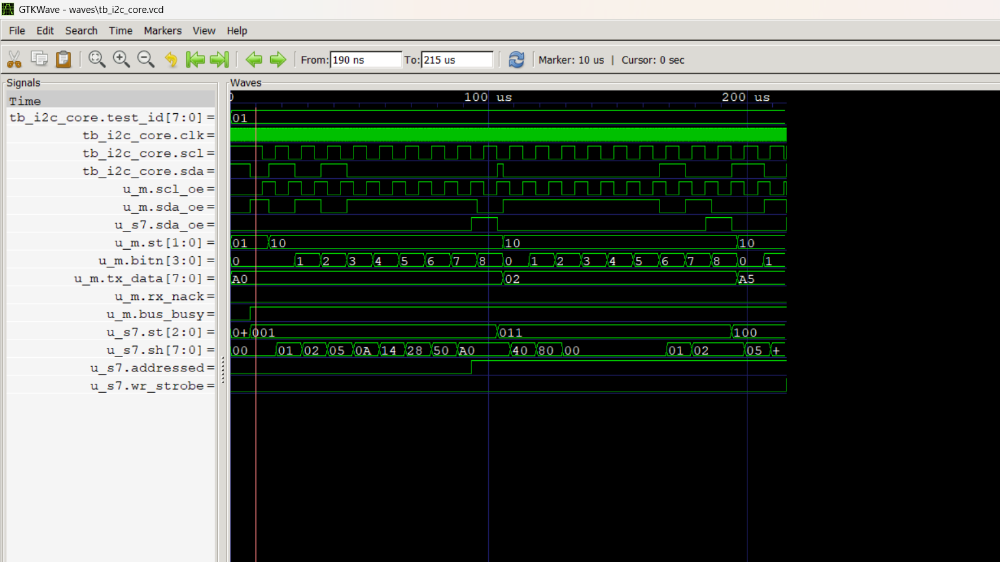

*Figure W1: T1 – 7-bit write at 100 kHz — `waves/tb_i2c_core.vcd`, window 0–215 µs.*

Master sends START, address byte 0xA0 (0x50 + W), register pointer 0x02 and data 0xA5. `u_m.bitn` counts bits 0–8; on the 9th clock `u_s7.sda_oe` pulls SDA low (ACK). `u_s7.addressed` rises after the address matches.

### 2. T2 – Repeated-START random read

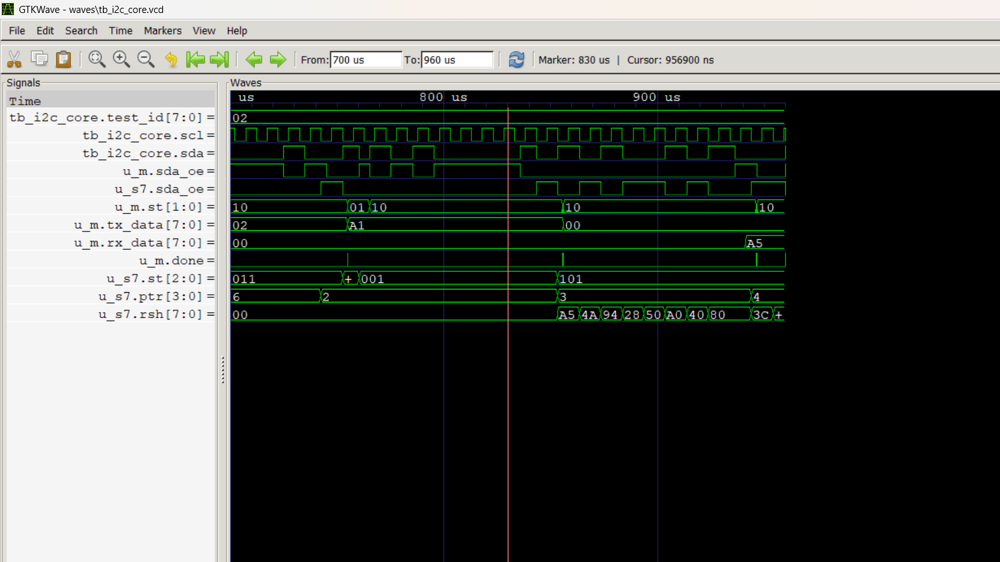

*Figure W2: T2 – Repeated-START random read — `waves/tb_i2c_core.vcd`, window 720–1000 µs (marker at the repeated START, 780.17 µs).*

After writing the pointer, the master issues a repeated START (`u_m.st` 01) and sends 0xA1 (read). The slave loads `rsh` with 0xA5 from register 2 and shifts it out; `u_m.rx_data` shows 0xA5 and `u_s7.ptr` auto-increments 2→3→4.

### 3. T3 – Address NACK

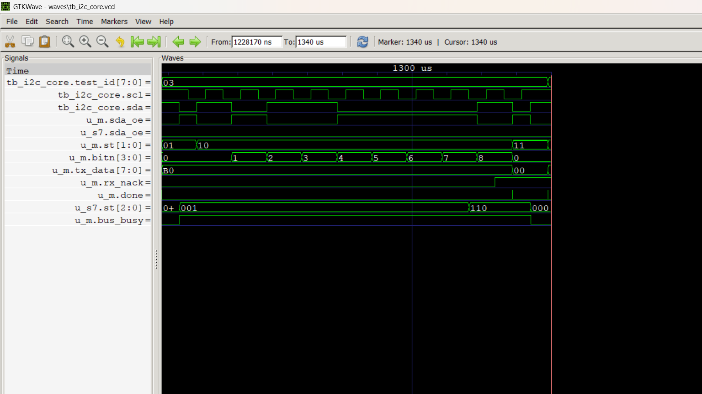

*Figure W3: T3 – Address NACK — `waves/tb_i2c_core.vcd`, window 1258–1380 µs.*

Address 0xB0 (0x58) has no slave, so no device drives SDA on the 9th clock. `u_m.rx_nack` goes high, `done` pulses and the master sends STOP; `bus_busy` drops.

### 4. T4 – 10-bit addressing

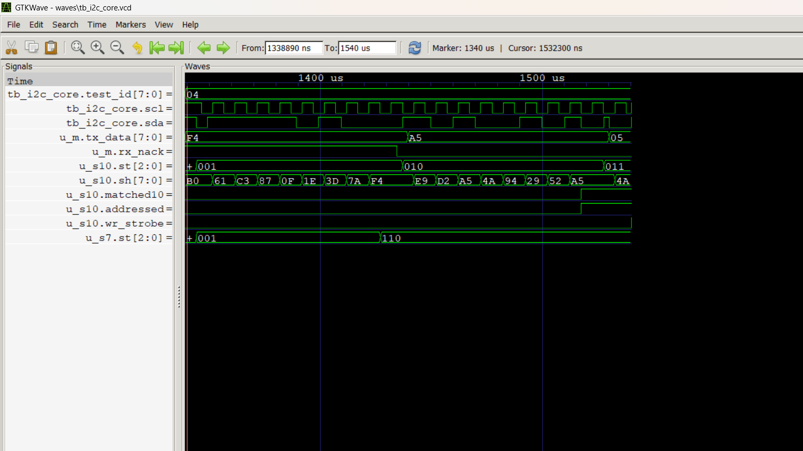

*Figure W4: T4 – 10-bit addressing — `waves/tb_i2c_core.vcd`, window 1381–1590 µs.*

Master sends the 10-bit header 0xF4 (11110 + A9:A8) then 0xA5 (A7:A0). The 10-bit slave `u_s10` ACKs both bytes, sets `matched10` and `addressed`, and the 7-bit slave stays idle.

### 5. T7 – Slave clock stretching

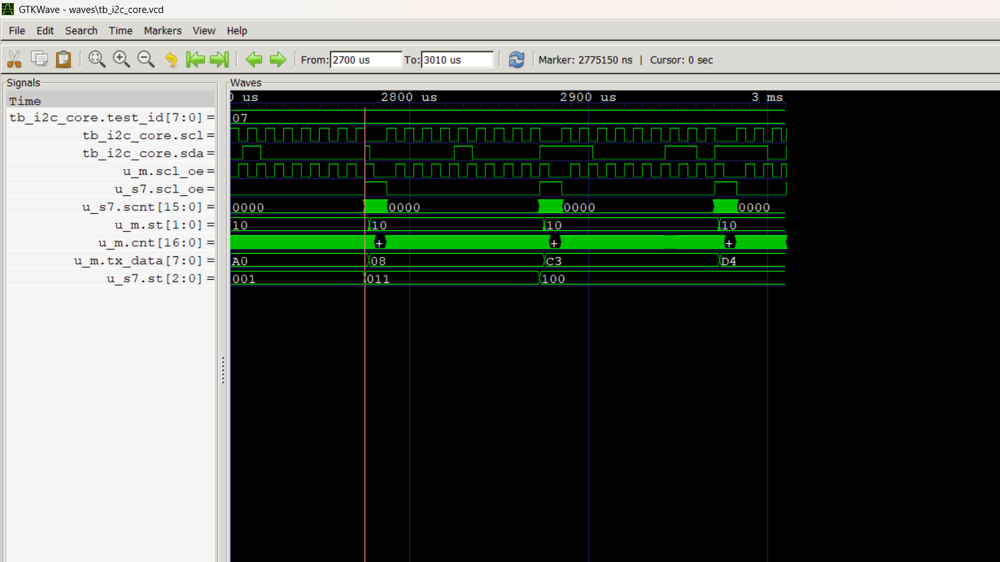

*Figure W5: T7 – Slave clock stretching — `waves/tb_i2c_core.vcd`, window 2700–3010 µs.*

After each ACK the slave holds SCL low (`u_s7.scl_oe`) while `scnt` counts. The master's `cnt` is frozen until SCL really goes high, so the low phase stretches to 12.06 µs (normal 5 µs) and no data is lost.

### 6. T8 – Fast-mode (370 kHz)

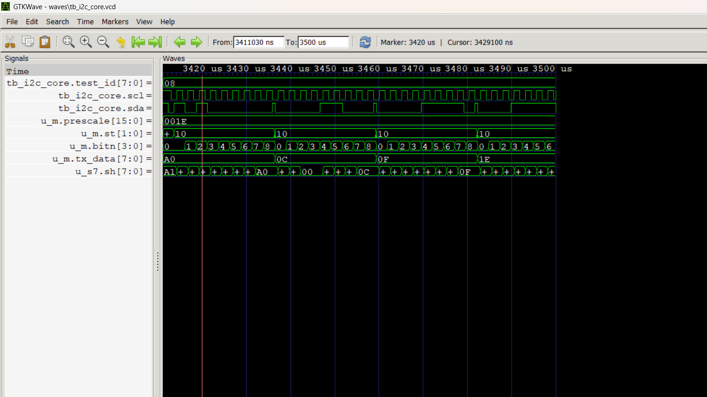

*Figure W6: T8 – Fast-mode (370 kHz) — `waves/tb_i2c_core.vcd`, window 3526–3620 µs.*

`u_m.prescale` = 0x20 (32) gives SCL = clk/(4·33+3) = 370.37 kHz measured. Bytes 0x0C, 0x0F, 0x1E are written back-to-back with ACKs.

### 7. Multi-master arbitration

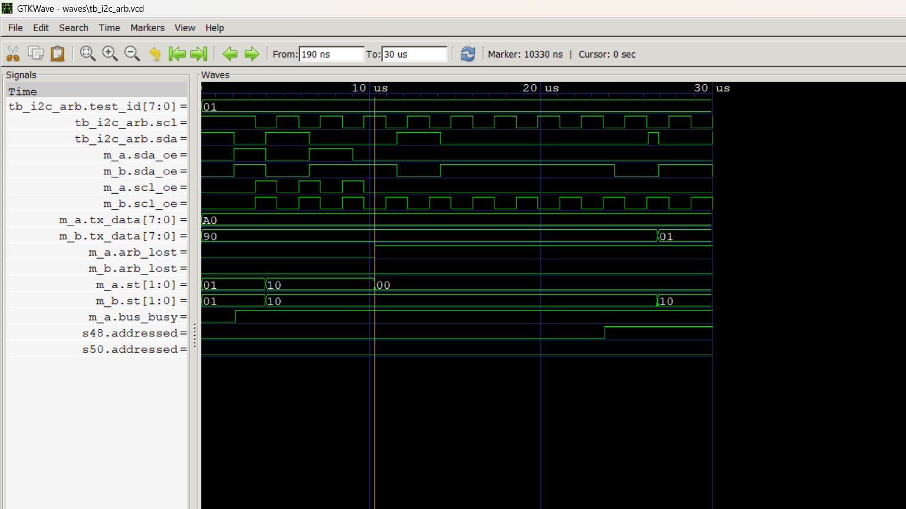

*Figure W7: Multi-master arbitration — `waves/tb_i2c_arb.vcd`, window 0–30 µs.*

Masters A (0xA0) and B (0x90) start together; SDA is the wired-AND of both. At the first bit where A sends 1 and B sends 0, A sees SDA low, releases the bus and goes idle (`m_a.st` 00, marker 10 330 ns, `arb_lost`). B continues uncorrupted and addresses slave 0x48 (`s48.addressed`).

### 8. APB register-driven transfer

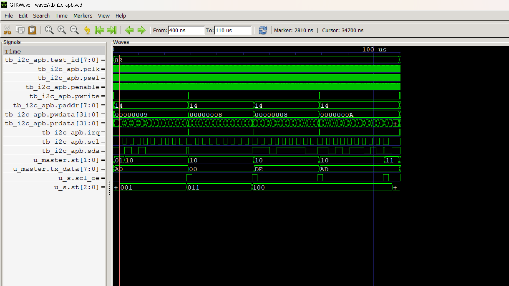

*Figure W8: APB register-driven transfer — `waves/tb_i2c_apb.vcd`, window 0.4–110 µs.*

Software writes TXDATA and CMD (pwdata 0x09 = START+WRITE, 0x08 = WRITE, 0x0A = WRITE+STOP) at paddr 0x10 and polls STATUS (0x14). Each byte sets `done`, which raises `irq`; the slave ACKs and stores 0xDE, 0xAD.

### 9. Command while busy is rejected

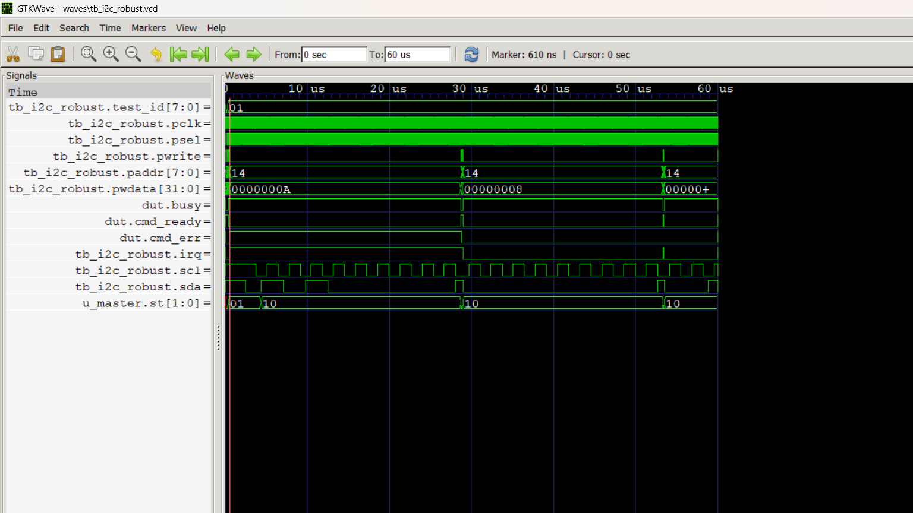

*Figure W9: `tb_i2c_robust` test 1 — `waves/tb_i2c_robust.vcd`, window 0–60 µs, marker 610 ns.*

START+WRITE 0xA0 is accepted (`dut.busy` rises, `cmd_ready` falls). A second CMD (0x0A, WRITE+STOP) written while busy is dropped: `cmd_err` and `irq` go high at once and stay high (sticky). The address byte on SCL/SDA continues unchanged. When the first command is done (about 28.8 µs) software writes 1 to STATUS bit 5 (W1C) and `cmd_err`/`irq` clear; later commands run normally.

### 10. Reset in the middle of a transfer (SDA stuck low)

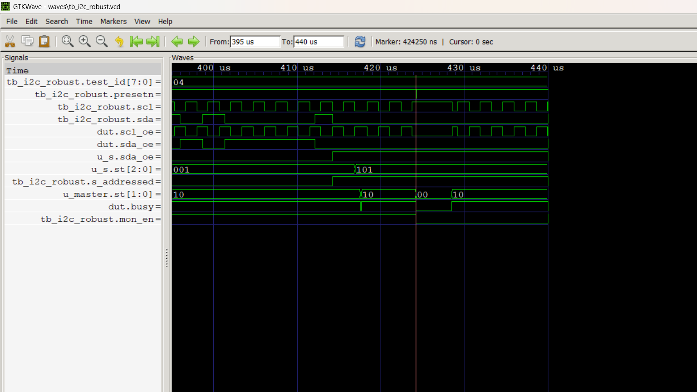

*Figure W10: `tb_i2c_robust` test 4 — window 395–440 µs, marker 424.25 µs.*

The slave is sending data byte 0x00 (`u_s.sda_oe`=1, `u_s.st`=101). At the marker only the APB/master is reset (`presetn` pulse). The master releases SCL and SDA, but the slave keeps SDA low, so the bus is stuck: SCL=1, SDA=0, `s_addressed`=1. No START is possible. The monitor is disabled around the abort.

### 11. Bus recovery (CMD.RECOVER)

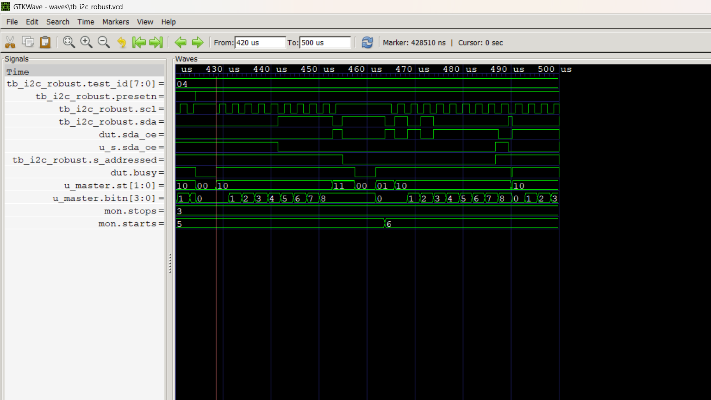

*Figure W11: `tb_i2c_robust` test 4 — window 420–500 µs, marker 428.51 µs (RECOVER accepted).*

RECOVER clocks SCL with SDA released (`u_master.bitn` 0–8). After a few pulses the slave finishes its byte and releases SDA (`u_s.sda_oe` 0), the master sends STOP, and `s_addressed` drops. The next transfer starts normally at about 464 µs (`mon.starts` 5→6) and is ACKed.

### 12. SCL-low timeout

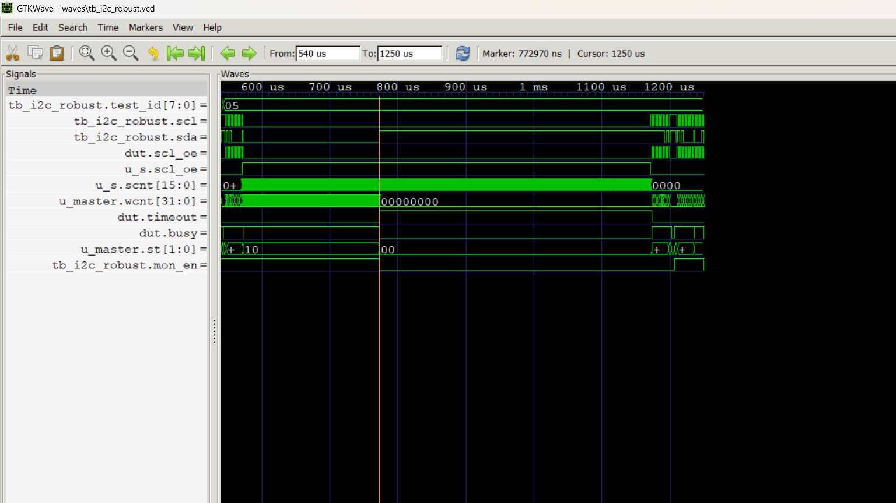

*Figure W12: `tb_i2c_robust` test 5 — window 540–1250 µs, marker 772.97 µs.*

The slave holds SCL low for 600 µs (`u_s.scl_oe`, `u_s.scnt`). The master's `wcnt` counts the wait. At 200 µs (`TIMEOUT_CLKS`=10000 in this TB) it aborts: `dut.timeout`=1, `busy`=0, `u_master.st`=00. After the slave lets go, RECOVER clears `timeout` and a normal transfer follows.

### 13. Fast-mode timing test (PRESCALE=32)

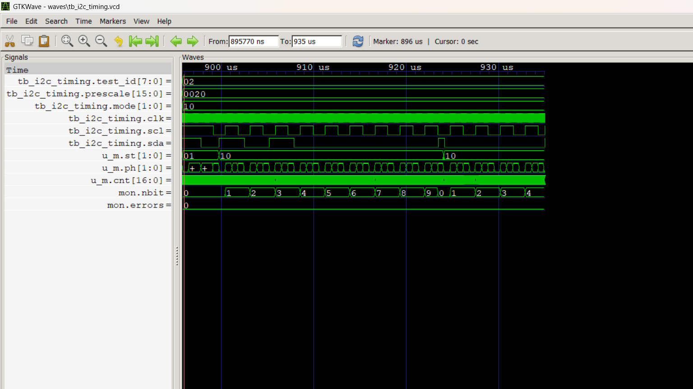

*Figure W13: `tb_i2c_timing` test 2 — `waves/tb_i2c_timing.vcd`, window 895.8–935 µs.*

`prescale`=0x20, `mode`=2 (Fast-mode limits). `u_m.ph` steps through the 4 phases of each bit and `mon.nbit` counts bits 1–9. `mon.errors` stays 0, so no timing or protocol violation is found.

## Synthesis (Yosys 0.70, run on the laptop)

Run on Windows with OSS CAD Suite 2026-11-01 (Yosys 0.70+286) in `C:\oss-cad-suite`, for the RTL at commit `c014668`. Script `scripts/synth.ys`, runner `scripts/synth.ps1`, logs in `synth/`. Each top is synthesized three ways: generic gates (`synth -flatten`), Lattice iCE40 (`synth_ice40`) and Xilinx 7-series (`synth_xilinx -family xc7`). `check -assert` passes for every run.

| Top | Generic cells | Generic FFs | iCE40 LUT4 | iCE40 FFs | iCE40 SB_CARRY | Xilinx LUTs | Xilinx FFs | Xilinx CARRY4 |
|---|---|---|---|---|---|---|---|---|
| `i2c_master` | 645 | 91 | 162 | 91 | 78 | 149 | 91 | 16 |
| `i2c_slave` (16 x 8 register file) | 1152 | 186 | 379 | 186 | 18 | 227 | 186 | 6 |
| `i2c_apb` (wrapper + master) | 826 | 124 | 230 | 124 | 78 | 197 | 128 | 16 |

Xilinx LUTs = LUT2..LUT6; I/O buffers (IBUF/OBUF/BUFG) are not counted. The slave register file is built from flip-flops (`Replacing memory \mem with list of registers`), so it uses no block RAM. These are post-synthesis numbers only; no place-and-route or timing analysis was run. CI also runs `scripts/synth.sh` with Ubuntu's Yosys package to check that the RTL still synthesizes.

## How to run (Windows, Icarus Verilog 12 in `C:\iverilog`)

```powershell
powershell -ExecutionPolicy Bypass -File scripts\run_all.ps1       # all 6 testbenches + negative test -> logs\
powershell -ExecutionPolicy Bypass -File scripts\gtkwave_shots.ps1 # GTKWave screenshots -> waveforms\
C:\iverilog\gtkwave\bin\gtkwave.exe -S scripts\gtkw\arb_lost.tcl waves\tb_i2c_arb.vcd
powershell -ExecutionPolicy Bypass -File scripts\synth.ps1       # Yosys (OSS CAD Suite) -> synth\
```

Linux/macOS: `bash scripts/run_all.sh` (see [How to run the verification](#how-to-run-the-verification)).

## Folder structure

```
rtl/      i2c_master.v, i2c_slave.v, i2c_apb.v
tb/       tb_i2c_core.v, tb_i2c_arb.v, tb_i2c_apb.v, tb_i2c_timing.v, tb_i2c_robust.v, tb_i2c_rand.v,
          i2c_monitor.v (protocol assertions + timing checker)
scripts/  run_all.ps1 (Windows), run_all.sh (Linux/CI), gtkwave_shots.ps1, gtkw/*.tcl (GTKWave views)
.github/  workflows/ci.yml (GitHub Actions)
logs/     simulation logs, summary.log
synth/    Yosys stat logs (generic, iCE40, Xilinx) from the laptop
waves/    VCDs (regenerated by run_all.ps1, not committed)
docs/     figs/ (block diagram, FSM diagrams and .dot sources)
waveforms/ GTKWave screenshots, one per test view (gtkwave_<view>.png)
scripts/synth.ys  Yosys script (synth.ps1 / synth.sh runners)
report/   report (docx, pdf)
```

## Limitations

- The master is byte-level: software (or the APB sequence) issues the address and data bytes; 10-bit addressing is two address bytes sent by software.
- No FIFO and no DMA; one byte per command. Commands written while busy are rejected (`cmd_err`), not queued.
- No glitch (spike) filter on SCL/SDA (Fast-mode tSP 50 ns), only 2-flop synchronisers.
- One prescaler sets the timing; tLOW and tHIGH cannot be set separately, so Fast-mode reaches 370 kHz (not 400 kHz) at 50 MHz. Fast-mode Plus (1 MHz) and Hs-mode are not supported.
- Rise/fall times and bus capacitance are not modelled; timing is checked at the digital edges.
- Arbitration is checked on data/address bits, not during the START condition itself.
- The slave is a simple 16 x 8 register file, clocked by the system clock (needs f_clk well above 8x SCL); it has no SCL timeout of its own.
- Verification is simulation only (Icarus Verilog): directed, constrained-random and assertion checks, but no formal proofs, functional-coverage database, gate-level simulation or hardware test.
- Synthesis only: no place-and-route, timing closure or gate-level simulation yet.

## Future work

- **FPGA validation**: put `i2c_apb` + a soft CPU or UART bridge on an FPGA board (e.g. Basys 3 / Arty A7) and talk to real I2C parts (EEPROM 24C02, temperature sensor, RTC) with a logic analyser to measure real rise/fall times and tSP.
- Separate tLOW/tHIGH registers for full 400 kHz and Fast-mode Plus, and a 50 ns spike filter.
- TX/RX FIFOs and a command queue, so software does not have to poll per byte.
- SystemVerilog/UVM environment with functional coverage, and SVA properties proven with SymbiYosys.
- Place-and-route (nextpnr) with timing analysis, and gate-level simulation after synthesis.

## License

MIT, see [LICENSE](LICENSE). Copyright (c) 2026 B. Srishanth Reddy.
